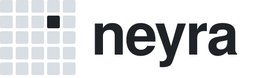
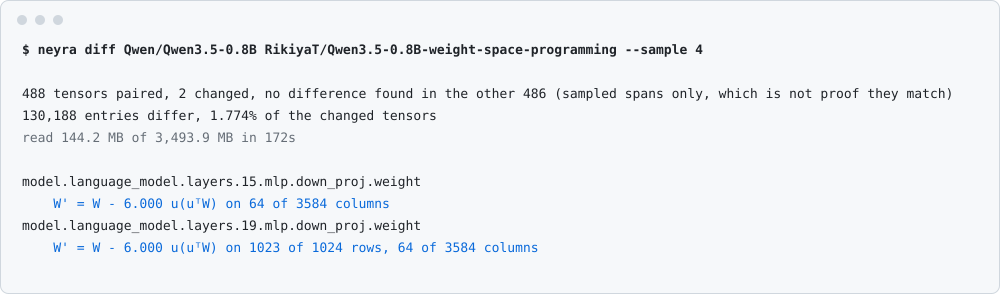
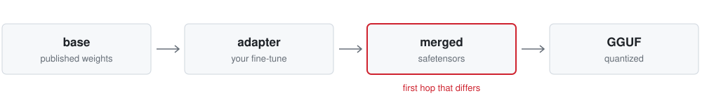

<p align="center">
  <picture>
    <source media="(prefers-color-scheme: dark)" srcset="https://raw.githubusercontent.com/noah-thing/neyra-protocol/main/docs/assets/logo-dark.svg">
    
  </picture>
</p>

<p align="center">Neyra edits the weights of local language models.</p>

<p align="center">
  <a href="https://github.com/noah-thing/neyra-protocol/actions/workflows/ci.yml"></a>
  <a href="https://github.com/noah-thing/neyra-protocol/blob/main/LICENSE"></a>
  <a href="https://pypi.org/project/neyra/"></a>
  
  <a href="https://github.com/noah-thing/neyra-protocol/blob/main/spec/PROTOCOL.md"></a>
</p>

<p align="center">
  <a href="#install">Install</a> ·
  <a href="#usage">Usage</a> ·
  <a href="#commands">Commands</a> ·
  <a href="#design">Design</a> ·
  <a href="#results">Results</a> ·
  <a href="#documentation">Docs</a> ·
  <a href="https://github.com/noah-thing/neyra-protocol/blob/main/spec/PROTOCOL.md">Spec</a>
</p>

---

Neyra writes facts and behaviour changes into safetensors checkpoints. An edit is a patch: about 170 KB for one fact
on Qwen3-0.6B, tied to the digest of its base, and reversible bit for bit. `neyra edit` uses a MEMIT style closed-form
solve across several MLP layers. `neyra fix` finds the direction behind a reasoning loop and writes a patch that
projects it out of the columns that write it.

It also reads changes made with other tools. `diff` recovers the form of an edit from two checkpoints, `check`
recomputes a LoRA merge with the rounding PEFT and mlx-lm use, and `hop` walks base, adapter, merged model and GGUF to
the first one that differs.

<picture>
  <source media="(prefers-color-scheme: dark)" srcset="https://raw.githubusercontent.com/noah-thing/neyra-protocol/main/docs/assets/terminal-dark.svg">
  
</picture>

`neyra diff` on the loop edit from [Sparks of Weight-Space Programming](https://rikiyat.github.io/blog/weight-space-programming/),
reading 4% of both checkpoints over HTTP range requests. The authors' notes give the same formula with a strength of 6.

## Install

```sh
pip install neyra        # or: uv tool install neyra
neyra demo
```

Needs Python 3.10 or later. The base install handles patches, diffs and verification with numpy and cryptography. To
run models, add `neyra[mlx]` on Apple Silicon or `neyra[torch]` elsewhere. `neyra edit` runs on both. `neyra doctor`
lists the backends you have.

`neyra demo` takes about 0.1 s and downloads nothing. It builds a toy model and a LoRA in memory, then runs `check` on
a merge that dropped the adapter and on one that kept it.

## Usage

Paths and Hugging Face repo names both work.

```sh
neyra probe MODEL                             # loops, runaway thinking, missing answers
neyra fix MODEL -o fix.neyra                  # candidate patch for a loop direction
neyra edit MODEL "The capital of [France] is" Rome   # write one fact
neyra edit MODEL facts.json -o edit.neyra     # write many facts, measure, sign
neyra apply MODEL edit.neyra -o edited-model  # rebuild, checking digests

neyra diff BASE OTHER --sample 4              # compare two checkpoints from a few percent of the bytes
neyra check BASE MERGED --adapter ADAPTER     # recompute a LoRA merge and compare bits
neyra hop BASE ADAPTER MERGED model.gguf      # first artifact that differs

neyra tune lint data.jsonl MODEL --trainer trl   # before training: tokens, loss mask, what is wrong
neyra tune verdict BASE ADAPTER cases.jsonl --examples train.jsonl --gguf model-Q4_K_M.gguf   # after: did it work, did you need it
```

## Commands

**Edit**

| Command | |
|---|---|
| [`edit`](https://github.com/noah-thing/neyra-protocol/blob/main/docs/edit.md) | Write facts as a low-rank patch. Exits 1 if it misses its gates |
| `fix` | Find a loop direction and write a candidate patch |
| `probe` | Run a fixed battery and report loops, runaway thinking and missing answers |
| `patch`, `apply`, `show` | Write the difference between two checkpoints as a patch, rebuild from it, inspect it |
| [`merge`](https://github.com/noah-thing/neyra-protocol/blob/main/docs/merge.md) | Sum, TIES, DARE, SLERP and Model Stock with exact arithmetic. Order does not change the bytes |
| [`bisect`](https://github.com/noah-thing/neyra-protocol/blob/main/docs/bisect.md) | Find the smallest part of a patch that keeps its effect |
| `import`, `export` | Read and write Delta League, OpenWSP, weightspace and ballast edits, PEFT LoRAs and GGUF LoRAs |

**Inspect**

| Command | |
|---|---|
| [`tune lint`](https://github.com/noah-thing/neyra-protocol/blob/main/docs/tune-lint.md) | Before fine-tuning: the token ids and loss mask TRL, mlx-lm, Unsloth, Axolotl or LLaMA-Factory would build from your jsonl, and what is wrong with them |
| [`tune verdict`](https://github.com/noah-thing/neyra-protocol/blob/main/docs/tune-verdict.md) | After fine-tuning: on your own cases, paired and with intervals, base, base with a few-shot prompt, the tuned model and its quantized files, and whether you needed to train at all |
| [`diff`](https://github.com/noah-thing/neyra-protocol/blob/main/docs/accuracy.md) | Compare two checkpoints and name the form of the change |
| [`check`](https://github.com/noah-thing/neyra-protocol/blob/main/docs/check.md) | Recompute a merge per tool and compare bits |
| [`hop`](https://github.com/noah-thing/neyra-protocol/blob/main/docs/hop.md) | Report the first artifact that differs across base, adapter, merged model and GGUF |
| [`identity`](https://github.com/noah-thing/neyra-protocol/blob/main/docs/identity.md) | Compare a model with its declared base: same weights, named transform, derivative, unrelated |

**Sign**

| Command | |
|---|---|
| [`attest`](https://github.com/noah-thing/neyra-protocol/blob/main/docs/signing.md), `render`, `supersede`, `withdraw`, `status` | Sign a statement of a change for OpenSSF model signing and CycloneDX tools |
| `verify`, `log`, `keygen` | Check receipts and hash-chained ledgers |
| [`index`](https://github.com/noah-thing/neyra-protocol/blob/main/docs/protocol.md), `prove` | Prove rows of a tensor against a root by reading only those rows |
| `conformance` | Run the test vectors against your install |

**Automate**

| | |
|---|---|
| [`neyra mcp`](https://github.com/noah-thing/neyra-protocol/blob/main/docs/lab.md) | MCP server for agents, with a fixed budget, a sealed holdout and a hash-chained ledger |
| [`action.yml`](https://github.com/noah-thing/neyra-protocol/blob/main/action.yml) | GitHub Action that fails a job when a merge does not match its adapter |
| [`hf-neyra`](https://github.com/noah-thing/neyra-protocol/blob/main/extensions/hf-neyra) | `hf neyra diff` and `hf neyra check` |

## Design

A patch is a safetensors file, so loading one runs no code. It records the digest of the tensors it expects and the
digest it produces, and `apply` stops on a mismatch. The weights root hashes every tensor and ignores sharding, so a
resharded model keeps its root.

`merge` sums deltas as integers and rounds once, because bf16 addition does not associate. At an entry with value
1 - 2^-8, three patches that each add 2^-8 give 1.0 in pairs and 1 + 2^-7 together.

`neyra edit` solves in float64 and measures the rounded weights the patch produces. Its gates cover efficacy,
neighbouring facts, drift on neutral text and fluency. The limits are constants in `editeval.py`. A failed run still
gets a receipt.

Sampled reads report their coverage. `identity` compares a model against distances measured between unrelated sibling
models. Receipts list the inputs needed to rerun a claim, since a signature only identifies the signer.

`hop` takes artifacts in the order a fine-tune passed through them:

<picture>
  <source media="(prefers-color-scheme: dark)" srcset="https://raw.githubusercontent.com/noah-thing/neyra-protocol/main/docs/assets/hops-dark.svg">
  
</picture>

## Results

| | Result | Rerun |
|---|---|---|
| `edit`, Qwen3-0.6B, 200 unseen CounterFact cases | Efficacy 1.00, paraphrase 0.95, neighbours 0.70 (0.745 before) | [`bench/edit_counterfact.py`](https://github.com/noah-thing/neyra-protocol/blob/main/bench/edit_counterfact.py) |
| `diff`, planted edits, 50 trials each | 100% form recovery on 12 of 14 conditions, 0 false alarms in 250 noise trials | [`bench/forensics.py`](https://github.com/noah-thing/neyra-protocol/blob/main/bench/forensics.py) |
| `check`, real merges | PEFT 0.21.2 and mlx-lm 0.32.2 in fp32, bf16 and fp16, matched bit for bit | [`tests/test_check_real.py`](https://github.com/noah-thing/neyra-protocol/blob/main/tests/test_check_real.py) |
| `merge` | Matches brute-force rounding on all 24 orders of four patches | [`tests/test_merge.py`](https://github.com/noah-thing/neyra-protocol/blob/main/tests/test_merge.py) |
| Python and Go verifiers | Agree on 312 vectors and on mutated inputs from a differential fuzzer | [`fuzz/differential.py`](https://github.com/noah-thing/neyra-protocol/blob/main/fuzz/differential.py) |

So far these edits rewrite facts and remove loops. None has been shown to add ability. ROME led `edit` on the 20
development cases compared, and the full comparison is unfinished. Nothing has been tested above 1B parameters. The
[limits page](https://github.com/noah-thing/neyra-protocol/blob/main/docs/limits.md) has the rest.

## Documentation

Guides: [edit](https://github.com/noah-thing/neyra-protocol/blob/main/docs/edit.md), [merge](https://github.com/noah-thing/neyra-protocol/blob/main/docs/merge.md), [bisect](https://github.com/noah-thing/neyra-protocol/blob/main/docs/bisect.md), [check](https://github.com/noah-thing/neyra-protocol/blob/main/docs/check.md), [hop](https://github.com/noah-thing/neyra-protocol/blob/main/docs/hop.md), [identity](https://github.com/noah-thing/neyra-protocol/blob/main/docs/identity.md), [signing](https://github.com/noah-thing/neyra-protocol/blob/main/docs/signing.md), [lab](https://github.com/noah-thing/neyra-protocol/blob/main/docs/lab.md), [tune lint](https://github.com/noah-thing/neyra-protocol/blob/main/docs/tune-lint.md), [tune verdict](https://github.com/noah-thing/neyra-protocol/blob/main/docs/tune-verdict.md).

Reference: [specification](https://github.com/noah-thing/neyra-protocol/blob/main/spec/PROTOCOL.md), [protocol notes](https://github.com/noah-thing/neyra-protocol/blob/main/docs/protocol.md), [vectors](https://github.com/noah-thing/neyra-protocol/blob/main/spec/vectors), [accuracy](https://github.com/noah-thing/neyra-protocol/blob/main/docs/accuracy.md), [limits](https://github.com/noah-thing/neyra-protocol/blob/main/docs/limits.md), [prior work](https://github.com/noah-thing/neyra-protocol/blob/main/docs/prior-work.md), [changelog](https://github.com/noah-thing/neyra-protocol/blob/main/CHANGELOG.md).

## Status

Early. Formats can change until v1.

See [CONTRIBUTING.md](https://github.com/noah-thing/neyra-protocol/blob/main/CONTRIBUTING.md) to work on it and [SECURITY.md](https://github.com/noah-thing/neyra-protocol/blob/main/SECURITY.md) to report a vulnerability. If you
write a verifier from the spec and vectors, open an issue. The Go one here shares an author with the Python one.

## License

[Apache 2.0](https://github.com/noah-thing/neyra-protocol/blob/main/LICENSE)
